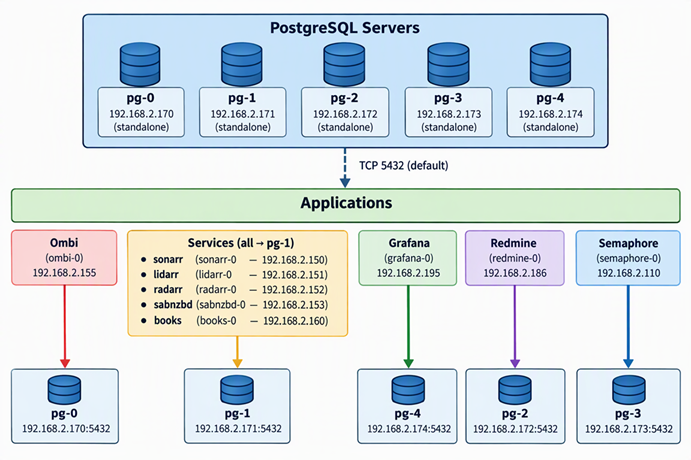

# 🐘 PostgreSQL Usage

PostgreSQL serves as the standardized relational database engine for all applications in the homelab that support it. Each application is provisioned with its own dedicated PostgreSQL server instance, ensuring clean separation of state, predictable performance, and simplified lifecycle management.

This page explains how applications map to PostgreSQL backends, why this pattern is used, and how contributors should think about database placement when adding new services.

## 🎯 Why PostgreSQL Is Standardized

Using PostgreSQL as the default database engine provides several advantages:

* Isolation between applications
* Predictable performance characteristics
* Unified automation and provisioning
* Consistent observability patterns
* Reduced contributor overhead

## 🗺️ Application‑to‑Database Mapping

The diagram below shows how each application connects to its assigned PostgreSQL server over TCP port 5432.

