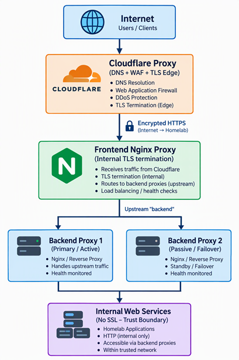

# 🌐 Reverse-Proxy

The Reverse-Proxy is the single public entry point into the homelab. It is a small Nginx cluster with one **frontend server** in the DMZ and two identical **backend proxy nodes** on an internal VLAN. The frontend handles everything that faces the client: TLS, routing, rate limits, and authentication. The backends only forward requests to application servers.

This page covers the ingress topology, the role of each tier, and how failover works. For how sign-in is enforced on top of this cluster, see [Reverse-Proxy with OAuth2 Integration](reverse-proxy_with_oauth2_integration.md).

---

## 🗺️ Architecture Overview



Traffic passes through three hops before reaching an application:

| Hop | Component | Network | Responsibility |
| --- | --- | --- | --- |
| 1 | Cloudflare | Internet | Hides the WAN IP, absorbs DDoS, first TLS hop |
| 2 | Frontend Nginx | DMZ | TLS termination, path allowlist, rate limits, auth, routing |
| 3 | Backend Nginx (rproxy-1 / rproxy-2) | Internal VLAN | Plain forwarding to application servers |

---

## ☁️ Cloudflare Edge

Public DNS records use Cloudflare's orange-cloud proxy mode, so they resolve to Cloudflare Anycast IPs instead of the homelab's residential WAN address. Clients, scanners, and crawlers never see the origin IP.

This layer:

- Prevents WAN IP leakage through DNS, logs, or direct scans
- Puts DDoS protection and a first TLS hop in front of the homelab
- Leaves room for later additions such as geo-routing or multi-region ingress

Orange-cloud proxying covers HTTP and HTTPS. Other protocols are not proxied and would expose the origin IP if published the same way.

👉 See Cloudflare's **[Proxy Status](https://developers.cloudflare.com/dns/proxy-status/)** documentation.

---

## 🖥️ Frontend Server

The frontend sits on the DMZ VLAN and accepts traffic only from Cloudflare. Every public hostname has a virtual host here, and every certificate lives here.

The backend cluster is defined once as an upstream block:


```nginx
http {
    # BEGIN ANSIBLE MANAGED BLOCK
    upstream backend {
        server rproxy-1:80 max_fails=3 fail_timeout=5s;
        server rproxy-2:80 backup;
    }
    # END ANSIBLE MANAGED BLOCK
}
```


A basic (unauthenticated) virtual host terminates TLS and hands the request to that upstream:


```nginx
server {
    listen 443 ssl http2;
    listen [::]:443 ssl http2;

    server_name homelab.refol.us;
    ssl_certificate     /data/certs/homelab.refol.us/fullchain.pem;
    ssl_certificate_key /data/certs/homelab.refol.us/privkey.pem;

    index index.html index.htm index.php;

    location / {
        proxy_pass http://backend;
    }
}
```


---

## ⚙️ Backend Servers

The two backend nodes are configured identically. They carry no certificates, no domain logic, and no authentication. They sit on an internal VLAN and accept traffic only from the frontend, never from the internet or Cloudflare directly.


```nginx
location / {
    proxy_pass http://192.168.2.186:80;
}
```


Because both nodes are identical, either one can carry the full load during a failover.

---

## 💠 High Availability

The backend tier runs **active–passive**, driven entirely by the frontend's upstream block.

- **Normal operation:** rproxy-1 receives all traffic. rproxy-2 stays running and idle.
- **Failure detection:** if rproxy-1 fails 3 times within 5 seconds (`max_fails=3`, `fail_timeout=5s`), Nginx marks it unavailable and sends traffic to rproxy-2.
- **Recovery:** after `fail_timeout` expires, Nginx tries rproxy-1 again and returns traffic to it once it responds.
- **Maintenance:** stopping rproxy-1 drains traffic to rproxy-2, so a node can be patched with minimal disruption.

Because the frontend makes the failover decision, there is no shared virtual IP, Keepalived, VRRP, or external load balancer to run.

The frontend itself is a single node. Redundancy currently applies to the backend tier only.

---

## 🎯 Why This Design?

- **One place for TLS and certificates.** All certificates are issued and renewed on the frontend, which keeps automation simple.
- **Small attack surface.** Only the frontend is reachable from outside. Backend IPs, ports, and application servers stay on internal VLANs.
- **Redundancy without extra moving parts.** One upstream block provides failover without a clustering stack.
- **Easy to grow.** Backend nodes can be added or removed without changing the frontend's virtual hosts.
- **Familiar pattern.** The layout mirrors Kubernetes ingress controllers, cloud load balancers (AWS ALB, GCP HTTPS LB), and enterprise DMZ designs.

---

## 🔐 Authentication

The frontend is also where user sign-in is enforced. Protected sites check each request against OAuth2 Proxy and Microsoft Entra ID before it is forwarded to the backends. Backends need no changes to support this.

👉 See: [Reverse-Proxy with OAuth2 Integration](reverse-proxy_with_oauth2_integration.md)
