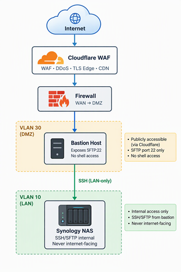
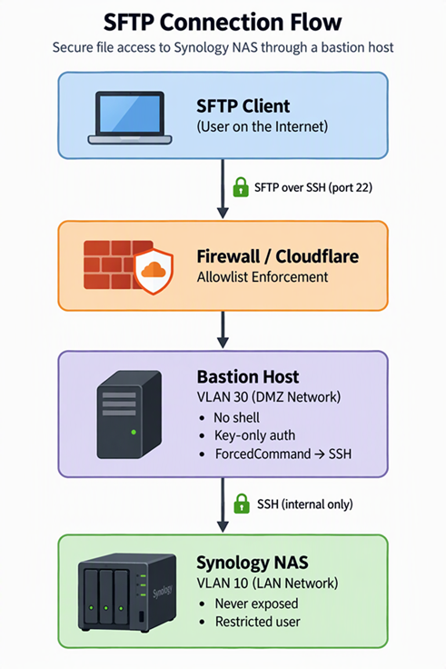

# 🛡️ Secure SFTP Publishing via Bastion to Synology

This page documents the architecture and implementation of **Pattern B**: exposing SFTP to the internet through a hardened **bastion host in the DMZ**, which transparently tunnels all SFTP traffic to **Synology** on the internal LAN.

Synology remains completely hidden from the internet and never placed in the DMZ. This pattern provides strong isolation, minimal attack surface, and clean firewall boundaries.

---

## 🌐 High‑Level Architecture



The bastion receives all external SFTP connections and immediately forwards them to Synology using a forced SSH command. Users never interact with the bastion filesystem.

---

## 🎯 Goals of This Pattern

- Keep Synology **off the DMZ** and **off the internet** entirely  
- Expose only a **minimal SFTP endpoint**  
- Enforce **key-only authentication**  
- Prevent lateral movement from DMZ → LAN  
- Maintain clean, auditable firewall rules  
- Provide a simple, predictable user experience

---

## 🧱 Bastion Host Responsibilities

The bastion acts as a **transparent SFTP relay**:

- Accepts inbound SFTP on port 22  
- Authenticates users via SSH keys  
- Immediately forwards the session to Synology  
- Provides no shell, no filesystem access, no local storage  
- Enforces chroot‑like isolation via forced commands  
- Logs all connection attempts  
- Runs fail2ban or equivalent rate limiting  

---

## 🔧 Implementation Steps

### Create a dedicated SFTP user on the bastion


```
sudo adduser sftpuser --shell /usr/sbin/nologin
```


This user cannot log in interactively.

---

### Generate SSH keys for the bastion → Synology connection


```
sudo -u sftpuser ssh-keygen -t ed25519 -f /home/sftpuser/.ssh/id_synology
```


Copy the public key to Synology:


```
ssh-copy-id -i /home/sftpuser/.ssh/id_synology.pub synologyuser@<synology-ip>
```


---

### Harden the bastion’s sshd_config

Add:


```
Match User sftpuser
    PasswordAuthentication no
    PubkeyAuthentication yes
    X11Forwarding no
    AllowTcpForwarding yes
    PermitTunnel no
    ForceCommand ssh -i /home/sftpuser/.ssh/id_synology synologyuser@192.168.10.50
```


This forces the bastion to immediately SSH into Synology on behalf of the user.

---

### Configure Synology

- Enable SSH/SFTP  
- Create a dedicated user (e.g., `synologyuser`)  
- Restrict to specific shared folders  
- Disable admin privileges  
- Disable shell access if possible  
- Apply least‑privilege permissions  

Synology only sees a single trusted SSH client: the bastion.

---

## 🔥 Firewall Rules

### WAN → DMZ
Allow:
- TCP 22 → Bastion  
- Only from Cloudflare IP ranges  

Deny everything else.

---

### DMZ → LAN
Allow:
- Bastion → Synology:22 (SSH)

Deny:
- All other DMZ → LAN traffic

This ensures the bastion cannot pivot.

---

## 🧩 Connection Flow



---

## 🧪 Security Properties

- Synology is **never reachable** from the internet  
- Synology is **not reachable** from the DMZ except via SSH from the bastion  
- Bastion has **no useful filesystem** for attackers  
- Users cannot escape the forced tunnel  
- Firewall boundaries remain clean and auditable  
- Cloudflare provides external filtering and rate limiting